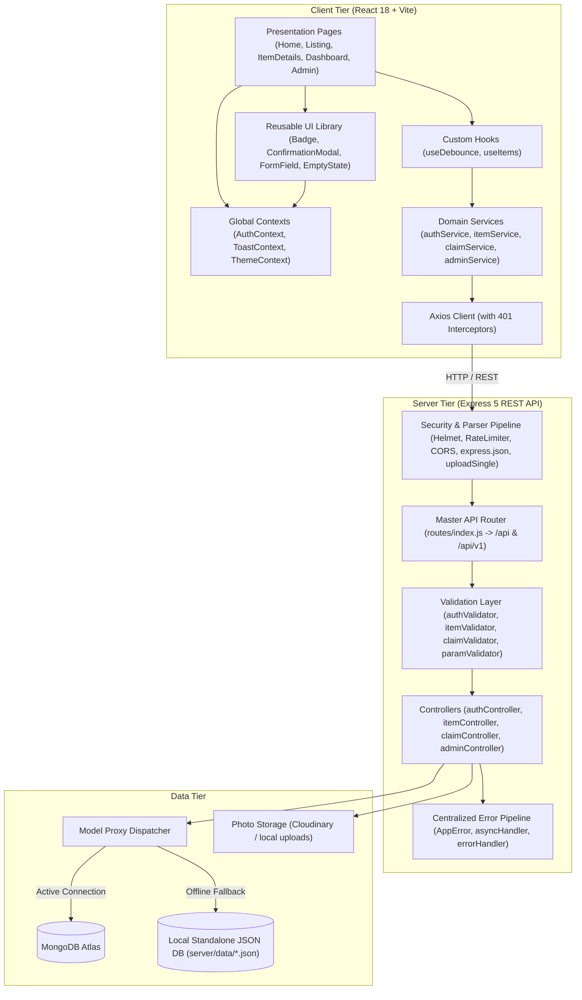

# Campus Lost and Found Portal - Technical Architecture Documentation

**Version**: 1.0.0  
**Phase**: Phase 2 — Architecture Refactoring (Task 2.12)  
**Status**: Active  

---

## 1. System Overview

The **Campus Lost and Found Portal** is an enterprise-grade full-stack web application designed for university and college campuses. It facilitates transparent reporting, categorization, debounced searching, and verified claims for misplaced belongings among students, faculty, and administrative staff.

The system follows a decoupled, layered client-server architecture built on Node.js, Express 5, React 18, and a Dual-Mode Database engine (MongoDB Atlas with automatic offline fallback to a local JSON proxy).



---

## 2. Frontend Architecture (`client/src/`)

### 2.1 Layered Directory Organization
```
client/src/
├── components/          # Reusable presentation and layout components
│   ├── Badge.jsx            # Variant-based status & type indicators
│   ├── ConfirmationModal.jsx# Accessible modal dialog (replaces window.confirm)
│   ├── EmptyState.jsx       # Standard empty listing/claim placeholder
│   ├── ErrorBoundary.jsx    # React error boundary catching render exceptions
│   ├── Footer.jsx           # Site footer
│   ├── FormField.jsx        # Accessible input field wrapper with validation
│   ├── ItemCard.jsx         # Card component for lost/found items
│   ├── Loader.jsx           # Animated loading spinner
│   ├── Navbar.jsx           # Accessible navigation bar with mobile toggle
│   ├── ProtectedRoute.jsx   # Route guard for authenticated & admin access
│   └── index.js             # Component barrel export
├── config/              # Centralized client configuration
│   └── env.js               # Validated environment variables (VITE_API_URL, etc.)
├── constants/           # Full-stack domain enums and taxonomy
│   └── index.js             # ITEM_TYPES, ITEM_STATUS, CLAIM_STATUS, CATEGORIES
├── context/             # Global React state providers
│   ├── AuthContext.jsx      # Authentication session & multi-tab sync
│   ├── ThemeContext.jsx     # Dark/light theme state & DOM sync
│   ├── ToastContext.jsx     # Global notification dispatcher & toast container
│   └── index.js             # Context barrel export
├── hooks/               # Custom reusable React hooks
│   ├── useDebounce.js       # Timer-based input debounce hook
│   └── useItems.js          # Item fetching, filtering, and pagination hook
├── pages/               # Top-level route views
│   ├── Admin.jsx            # Administration moderation panel
│   ├── Dashboard.jsx        # User portal (my items & claims)
│   ├── Home.jsx             # Landing page with recent items
│   ├── ItemDetails.jsx      # Detailed view with claim submission
│   ├── Listing.jsx          # Search and filterable catalog
│   ├── Login.jsx            # User authentication form
│   ├── Register.jsx         # User registration form
│   └── ReportItem.jsx       # Lost/found item submission form
├── services/            # Domain API abstraction layer
│   ├── adminService.js      # Admin management HTTP endpoints
│   ├── api.js               # Base Axios instance with auth interceptor
│   ├── authService.js       # Auth & profile HTTP endpoints
│   ├── claimService.js      # Claim submission & decision HTTP endpoints
│   ├── itemService.js       # Item catalog & report HTTP endpoints
│   └── index.js             # Service barrel export
├── utils/               # Formatting and helper utilities
│   └── formatters.js        # Date, time, and currency formatters
├── App.jsx              # Root router and context provider composition
├── main.jsx             # React entry point
└── index.css            # Modular design token stylesheet
```

### 2.2 Global State Architecture
- **`AuthContext`**: Manages `user`, `token`, `isAuthenticated`, and `isAdmin`. It listens to browser `storage` events to synchronize logins and logouts across multiple browser tabs instantaneously.
- **`ToastContext`**: Provides `showSuccess`, `showError`, and `showInfo` methods to dispatch floating feedback toasts that persist across route transitions with auto-dismiss timers and accessible SVG indicators.
- **`ThemeContext`**: Persists `light`, `dark`, or `system` themes to `localStorage` and synchronizes the root DOM attribute `data-theme`.

### 2.3 Network Abstraction & Error Handling
- Direct Axios calls are completely removed from UI pages. All HTTP requests are channeled through dedicated domain services (`authService`, `itemService`, `claimService`, `adminService`).
- `services/api.js` automatically attaches JWT bearer tokens to outgoing requests and intercepts 401 Unauthorized responses to purge stale tokens and redirect to `/login`.
- Global UI safety is ensured by `ErrorBoundary.jsx` which wraps the primary route outlet in `App.jsx`, preventing white-screen crashes on unexpected render errors.

---

## 3. Backend Architecture (`server/`)

### 3.1 Directory Organization
```
server/
├── config/              # Central configuration & database connectors
│   ├── db.js                # MongoDB Mongoose connection manager
│   ├── env.js               # Validated environment configuration module
│   └── localDb.js           # Standalone JSON database engine
├── constants/           # Domain enums and system constants
│   └── index.js             # ITEM_TYPES, ITEM_STATUS, CLAIM_STATUS, USER_ROLES
├── controllers/         # Thin business logic handlers
│   ├── adminController.js   # Admin user and item moderation
│   ├── authController.js    # Register, login, and profile retrieval
│   ├── claimController.js   # Claim creation, retrieval, and decision
│   └── itemController.js    # Item CRUD and catalog search
├── data/                # Standalone local database JSON files
│   ├── claims.json          # Local claims storage
│   ├── items.json           # Local items storage
│   └── users.json           # Local users storage
├── middleware/          # Request processing pipeline
│   ├── asyncHandler.js      # Higher-order wrapper passing errors to next()
│   ├── auth.js              # JWT verification and role authorization
│   ├── errorHandler.js      # Centralized error handler with AppError
│   ├── rateLimiter.js       # IP-based rate limiting policies
│   └── upload.js            # Multer file upload (Cloudinary + local fallback)
├── models/              # Schema models with local proxy dispatch
│   ├── Claim.js             # Claim Mongoose model
│   ├── Item.js              # Item Mongoose model
│   └── User.js              # User Mongoose model
├── public/uploads/      # Local uploaded images directory
├── routes/              # Modular Express routing
│   ├── admin.js             # Admin management routes
│   ├── auth.js              # Authentication routes
│   ├── claims.js            # Claim routes
│   ├── index.js             # Master API router (aggregates all sub-routes)
│   └── items.js             # Item catalog routes
├── utils/               # Backend helper utilities
│   └── appError.js          # Operational error class
├── validators/          # Modular request validation layer
│   ├── authValidator.js     # Register & login validation chains
│   ├── claimValidator.js    # Claim creation & decision validation chains
│   ├── index.js             # Validator barrel export
│   ├── itemValidator.js     # Item create & update validation chains
│   ├── paramValidator.js    # MongoDB ObjectId route parameter validator
│   └── validate.js          # Express-validator evaluation middleware
├── nodemon.json         # Nodemon configuration ignoring data/ and uploads/
├── package.json         # Server dependency manifest
├── seed.js              # Database seed script for development
└── server.js            # Express application entrypoint
```

### 3.2 Master API Router & Multi-Version Support
All domain sub-routers are mounted inside `server/routes/index.js`. The main server entry point mounts this router under both `/api` and `/api/v1`:
```javascript
const apiRouter = require("./routes");
app.use("/api/v1", apiRouter);
app.use("/api", apiRouter);
```
This guarantees backward compatibility for existing client consumers while allowing future versioned client integrations.

### 3.3 Validation Layer (`server/validators/`)
Request validation is decoupled from controllers using `express-validator`:
1. **Rule Chains**: Defined declaratively per resource (`authValidator.js`, `itemValidator.js`, `claimValidator.js`).
2. **Parameter Validator**: `validateMongoId` verifies route parameters (`:id`) and rejects malformed IDs with a 400 Bad Request before hitting controllers.
3. **Execution Middleware**: `validate.js` evaluates validation results and forwards the first formatted error message as an `AppError` to Express's global error handler.

### 3.4 Error Handling Pipeline
The application uses an operational error pattern:
- **`AppError`**: Subclasses `Error` to mark operational errors with explicit HTTP status codes (`isOperational: true`).
- **`asyncHandler`**: Wraps all asynchronous controller methods, catching unhandled rejections and forwarding them to `next(err)`.
- **`errorHandler`**: Centralized middleware that intercepts Mongoose `CastError`, `ValidationError`, duplicate key code `11000`, and JWT errors. In production, stack traces are sanitized to prevent internal implementation details from leaking.

---

## 4. REST API Endpoint Specification

All endpoints are available under `/api` and `/api/v1`.

| Method | Endpoint | Auth Level | Rate Limit | Request Body | Description |
| :--- | :--- | :--- | :--- | :--- | :--- |
| `GET` | `/health` | Public | Standard | None | Health check endpoint |
| `POST` | `/auth/register` | Public | Standard | `{ name, email, password, phone? }` | Register new user account |
| `POST` | `/auth/login` | Public | 5 req / 15m | `{ email, password }` | Authenticate and issue JWT |
| `GET` | `/auth/me` | User | Standard | None | Get current user profile |
| `GET` | `/items` | Public | Standard | Query: `q`, `type`, `category`, `status`, `page`, `limit` | Paginated item search & filter |
| `GET` | `/items/:id` | Public | Standard | Param: `id` (ObjectId) | Get single item details |
| `POST` | `/items` | User | Standard | `multipart/form-data`: `type`, `title`, `description`, `category`, `location`, `dateOfEvent`, `image?` | Report lost or found item |
| `PUT` | `/items/:id` | Owner | Standard | `{ title?, description?, category?, location?, dateOfEvent?, type?, status? }` | Update item report |
| `DELETE`| `/items/:id` | Owner/Admin | Standard | Param: `id` (ObjectId) | Delete item report |
| `POST` | `/items/:id/claims` | User | Standard | `{ message, proofDetails }` | Submit ownership claim |
| `GET` | `/claims/mine` | User | Standard | None | Get claims made and received |
| `PATCH`| `/claims/:id` | Item Owner | Standard | `{ decision: "approved" \| "rejected" }` | Decide on pending claim |
| `GET` | `/admin/users` | Admin | Standard | None | List all registered users |
| `PATCH`| `/admin/users/:id/deactivate` | Admin | Standard | Param: `id` (ObjectId) | Deactivate user account |
| `PATCH`| `/admin/users/:id/activate` | Admin | Standard | Param: `id` (ObjectId) | Re-activate user account |
| `GET` | `/admin/items` | Admin | Standard | None | List all items across all statuses |

---

## 5. Security & Rate Limiting Controls

1. **HTTP Security Headers**: Express uses `helmet({ crossOriginResourcePolicy: false })` to enforce safe headers while permitting cross-origin rendering of uploaded item photos.
2. **CORS Restrictions**: Origin whitelist dynamically respects `CLIENT_URL` configuration in production and permits local Vite development (`http://localhost:5173`).
3. **Rate Limiting**:
   - Global API Limiter: 100 requests per 15-minute window per IP.
   - Authentication Limiter: 5 requests per 15-minute window per IP for `/api/auth/login`.
4. **Data Privacy Masking**:
   - In `/api/claims/mine`, claimant contact information (email, phone) is masked until the item reporter explicitly marks the claim `approved`.
   - Passwords are encrypted using `bcryptjs` with salt work factor 10. Password hashes are never returned by user query endpoints (`select("-passwordHash")`).

---

## 6. Deployment & CI/CD Pipeline

The project is configured for single-service full-stack deployment on **Render**:
- **Staging Web Service**: `find-lost-staging` (tracking the `staging` branch).
- **Production Web Service**: `find-lost-production` (tracking the `main` branch).
- **Build Step**: Compiles client assets into `client/dist/`. Express serves these static assets and handles SPA client-side fallback routes for non-API GET requests.
- **Run Step**: `node server/server.js` starts the production Express daemon.
