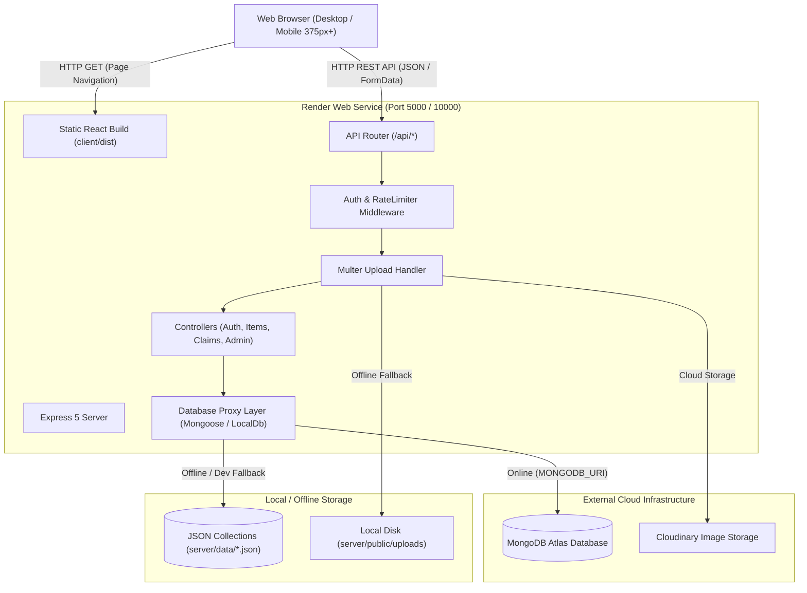

# Technical Requirements Document (TRD)

**Project Name**: Campus Lost and Found Portal  
**Document Version**: 1.0.0  
**Phase**: Phase 1 — Planning Documents (Task 2)  
**Status**: Ready for Review  

---

## 1. System Architecture Overview

The system utilizes a client-server architecture built on the MERN stack (MongoDB, Express, React, Node.js). For cloud production on Render, the system operates as a unified web service where Express serves both the REST API and the compiled React SPA static assets.



---

## 2. Technology Stack Selection & Rationales

| Layer | Selected Technology | Version | Architectural Justification |
| :--- | :--- | :--- | :--- |
| **Frontend Framework** | React | `^18.3.1` | Component-driven architecture, robust ecosystem, high community support. |
| **Frontend Tooling** | Vite | `^5.4.11` | Instant HMR, optimized Rollup production bundling, sub-second build times. |
| **Client Routing** | React Router DOM | `^6.28.0` | Declarative client-side routing, protected route wrappers, dynamic parameter matching. |
| **HTTP Client** | Axios | `^1.7.9` | Request/response interceptors for automatic JWT Bearer token attachment, unified error handling. |
| **Styling** | Vanilla Modular CSS | CSS3 | Zero runtime overhead, no CSS-in-JS bundle penalty, custom responsive design system. |
| **Backend Runtime** | Node.js | `>=18.0.0` | Non-blocking asynchronous I/O, native JSON handling, extensive library ecosystem. |
| **Web Framework** | Express | `^5.3.0` | Minimalist HTTP server with native promise handling in Express 5 route handlers. |
| **Database ORM** | Mongoose | `^9.11.4` | Schema enforcement, document validation, relationship population (`ref`). |
| **Offline DB Fallback** | Custom LocalCollection | Native Node.js | Zero-setup offline evaluation; file-backed JSON store matching Mongoose query APIs. |
| **Authentication** | JSON Web Tokens (`jsonwebtoken`) | `^9.0.3` | Stateless authentication, signed with HMAC-SHA256, 7-day expiration. |
| **Password Hashing** | `bcryptjs` | `^3.0.3` | Adaptive key derivation function (10 salt rounds) resistant to rainbow table and brute-force attacks. |
| **Security & Headers** | `helmet`, `cors` | `^8.3.0`, `^2.8.6` | HTTP header security (`X-Content-Type-Options`, `X-Frame-Options`), strict CORS policy. |
| **Rate Limiting** | `express-rate-limit` | `^8.7.2` | Memory-efficient rate limiting defending against brute force and DDoS. |
| **Input Validation** | `express-validator` | `^7.3.2` | Declarative request payload sanitization and constraint validation. |
| **File Uploads** | `multer`, `multer-storage-cloudinary` | `^2.5.0`, `^4.0.0` | Multi-part form-data parsing, file size limits (2MB), format filtering (`jpg, jpeg, png, webp`). |

---

## 3. Directory & Module Structure

```
Find & lost/
├── client/                     # Frontend Application
│   ├── src/
│   │   ├── components/         # Reusable UI widgets (Alert, Navbar, Footer, ItemCard, Loader, ProtectedRoute)
│   │   ├── context/            # React Contexts (AuthContext for user session & JWT token)
│   │   ├── pages/              # Route views (Home, Listing, ItemDetails, ReportItem, Dashboard, Admin, Login, Register)
│   │   ├── services/           # API communication layer (Axios instance with auto-token interceptor)
│   │   ├── App.jsx             # Top-level routing and layout composition
│   │   ├── index.css           # Global stylesheet and CSS design tokens
│   │   └── main.jsx            # React root mount
│   ├── index.html              # HTML shell
│   ├── package.json            # Client dependencies and Vite scripts
│   └── vite.config.js          # Vite config with /api development proxy
│
├── server/                     # Backend Application
│   ├── config/
│   │   ├── db.js               # MongoDB connection initializer & connectivity probing
│   │   └── localDb.js          # Standalone file-backed database engine mimicking Mongoose Model APIs
│   ├── controllers/            # Request handlers
│   │   ├── adminController.js  # User moderation & global item deletion
│   │   ├── authController.js   # Registration, login, and /auth/me profile
│   │   ├── claimController.js  # Claim creation, privacy-masked retrieval, decision handling
│   │   └── itemController.js   # Item CRUD, text search, faceted filtering, pagination
│   ├── data/                   # JSON storage files for offline/standalone mode (users.json, items.json, claims.json)
│   ├── middleware/             # Express middlewares
│   │   ├── auth.js             # JWT verification & adminOnly role authorization
│   │   ├── rateLimiter.js      # Global API limiter (100 req/15m) & login limiter (5 req/15m)
│   │   └── upload.js           # Multer storage configuration (Cloudinary / local disk fallback)
│   ├── models/                 # Proxy models routing dynamically to Mongoose or LocalDB
│   │   ├── Claim.js            # Claim schema & proxy wrapper
│   │   ├── Item.js             # Item schema & proxy wrapper
│   │   └── User.js             # User schema & proxy wrapper
│   ├── public/uploads/         # Local disk storage for item images (.gitkeep preserved)
│   ├── routes/                 # REST endpoint routers (/auth, /items, /claims, /admin)
│   ├── nodemon.json            # Nodemon ignore settings (prevents data/*.json reload loops)
│   ├── package.json            # Server dependencies and start scripts
│   └── server.js               # Express application entry point & static SPA fallback
│
├── docs/                       # Engineering & Launch Documentation
│   ├── planning/               # Phase 1 planning specifications
│   │   ├── 01_PRD.md           # Product Requirements Document
│   │   └── 02_TRD.md           # Technical Requirements Document
│   ├── ASSUMPTIONS.md          # Technical and operational assumptions log
│   └── DECISIONS.md            # Architecture decision records
├── render.yaml                 # Render Blueprint specification for cloud deployment
├── package.json                # Root orchestrator (concurrent dev, root build, postinstall)
├── README.md                   # Project documentation & onboarding guide
└── TESTING.md                  # Official test case verification evidence
```

---

## 4. API & Data Contract Standards

### 4.1 Response Envelope Structure
- **Success Responses**: Standard HTTP status code (`200 OK`, `201 Created`) with direct JSON payload or object envelope:
  ```json
  {
    "items": [...],
    "total": 24,
    "page": 1,
    "pages": 2
  }
  ```
- **Error Responses**: Appropriate HTTP status code (`400`, `401`, `403`, `404`, `409`, `500`) with consistent message format:
  ```json
  {
    "message": "Descriptive human-readable error explanation"
  }
  ```

### 4.2 Core RESTful Routes

| Route | Method | Access | Function |
| :--- | :---: | :---: | :--- |
| `/api/health` | `GET` | Public | Server uptime and health probe. |
| `/api/auth/register` | `POST` | Public | Register new user account; validates email and password. |
| `/api/auth/login` | `POST` | Public | Authenticate user; returns JWT token and user profile. |
| `/api/auth/me` | `GET` | Protected | Returns profile of authenticated user. |
| `/api/items` | `GET` | Public | List and search items with faceted filters and pagination. |
| `/api/items/:id` | `GET` | Public | Retrieve detailed view of a single item. |
| `/api/items` | `POST` | Protected | Create new item report with optional image upload. |
| `/api/items/:id` | `PUT` | Protected | Update item report (creator only). |
| `/api/items/:id` | `DELETE` | Protected | Delete item report (creator or admin). |
| `/api/items/:id/claims` | `POST` | Protected | Submit ownership claim with proof details. |
| `/api/claims/mine` | `GET` | Protected | Fetch user's submitted and received claims (masked privacy). |
| `/api/claims/:id` | `PATCH` | Protected | Approve or reject claim (item reporter only). |
| `/api/admin/users` | `GET` | Admin | List all registered users (excluding password hashes). |
| `/api/admin/users/:id/deactivate` | `PATCH` | Admin | Deactivate an account (blocks login). |
| `/api/admin/users/:id/activate` | `PATCH` | Admin | Re-activate a deactivated account. |
| `/api/admin/items` | `GET` | Admin | List all items across all statuses for moderation. |

---

## 5. Security & Privacy Architecture

1. **Authentication Token Lifecycle**:
   - Algorithm: HS256 using `JWT_SECRET`.
   - Payload: `{ id: user._id, role: user.role }`.
   - Validity: 7 days.
   - Storage: Client `localStorage`, injected into HTTP requests via Axios interceptor: `Authorization: Bearer <token>`.
2. **Contact Privacy Guard**:
   - In `claimController.getMyClaims`, claimant email and phone numbers are dynamically stripped from claim objects unless `status === "approved"`.
3. **Double Brute-Force Shielding**:
   - Global rate limiter restricts abusive scraping across all endpoints (100 req / 15 min).
   - Strict login limiter isolates `/api/auth/login` to prevent credential stuffing (5 attempts / 15 min per IP).
4. **Injection & Parameter Tampering Protection**:
   - Schema-enforced typing via Mongoose and `express-validator`.
   - File uploads restricted to valid image MIME types (`image/jpeg`, `image/png`, `image/webp`) with a hard 2MB size cap.

---

## 6. Resource Limits & Scalability Constraints (Render Free Tier)

- **Memory Ceiling**: 512 MB RAM limit on Render Free Tier instance.
- **Node.js Concurrency**: Single event-loop process (`WEB_CONCURRENCY=1`).
- **Disk Persistence on Cloud**: Free container filesystems are ephemeral. Standalone JSON files and local uploads reset upon container restart; production multi-user deployments must supply `MONGODB_URI` (Atlas) and Cloudinary credentials in Render environment variables.
- **Cold Start Handling**: Free tier containers spin down after 15 minutes of inactivity; `/api/health` probe serves as an automated keep-alive target.

