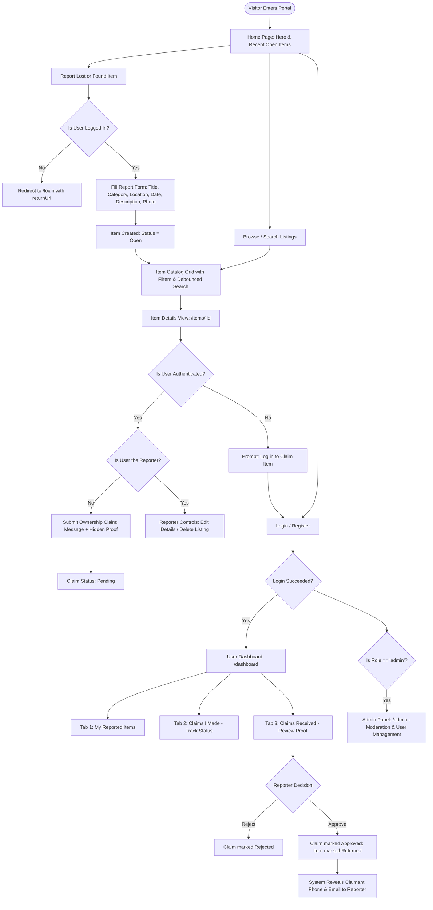

# App Flow & UI/UX Design Brief

**Project Name**: Campus Lost and Found Portal  
**Document Version**: 1.0.0  
**Phase**: Phase 1 — Planning Documents (Task 3)  
**Status**: Ready for Review  

---

## 1. User Journey & App Flow Maps

### 1.1 Complete End-to-End Application State Flow

---

## 2. Page-by-Page Information Architecture

### 2.1 Home Page (`/`)
- **Header**: Navigation bar containing campus portal brand name, Browse Items link, "+ Report Item" call-to-action button, and dynamic auth status (Login/Register or Hi, User Name + Dashboard/Admin + Logout).
- **Hero Section**: Clear, direct heading: *"Campus Lost and Found Portal"*. Supporting sub-headline describing the verified campus registry. Two primary rectangular action buttons: *"Report a Lost Item"* and *"Report a Found Item"*. Zero hype or exaggerated statistics.
- **Recent Open Listings Section**: Grid displaying the 6 most recent unresolved items with status tags, thumbnail images, category, location, and date of event. "View All Listings" link pointing to `/items`.
- **Footer**: Campus attribution, copyright notice, legal links (Privacy Policy, Terms of Use), and direct contact link.

### 2.2 Browse & Search Page (`/items`)
- **Filter & Search Bar**:
  - Full-width search input with 500 ms debounce handler.
  - Type selector dropdown (`All Types`, `Lost Items Only`, `Found Items Only`).
  - Category selector dropdown (`Electronics`, `Documents`, `Accessories`, `Books`, `Bags`, `Keys`, `Clothing`, `Other`).
  - "Clear Filters" button active when any filter is populated.
- **Results Grid**: Responsive multi-column grid of item cards (3 columns on desktop, 2 on tablet, 1 on mobile).
- **Card Contents**: Status indicator badge (`Lost` in crimson or `Found` in forest green), photographic preview with graceful SVG fallback, item title, category, location, and date.
- **Pagination Controls**: Page numbers and Next / Previous buttons for catalog navigation.
- **Empty State**: Friendly, non-blocking notification when no records match the filter criteria.

### 2.3 Item Details View (`/items/:id`)
- **Two-Column Responsive Layout**:
  - **Left Column**: High-resolution image view with click-to-expand capability and broken-image placeholder handling.
  - **Right Column**: Badge header (`Lost` / `Found`, `Open` / `Returned`), item title, metadata list (Category, Location, Date of Event, Reported By), full description text block.
- **Conditional Actions**:
  - **Reporter View**: "Edit Details" and "Delete Listing" buttons.
  - **Claimant View (Item Open)**: In-line form with "Message to Finder" and "Identifying Proof Details" (specifying that secret details will be shared only with the reporter).
  - **Claimant View (Item Returned)**: Visual notice stating the item has already been claimed and resolved.
  - **Unauthenticated View**: Direct link prompting user to log in before submitting a claim.

### 2.4 Report Item Form (`/report`)
- **Type Toggle**: Radio option to designate `Lost Item` (I lost it) or `Found Item` (I found it).
- **Core Form Fields**:
  - Item Title (text input, max 100 characters).
  - Category (dropdown selection).
  - Date of Incident (HTML5 date picker).
  - Campus Location (text input with specific location examples, e.g., Library 2nd Floor).
  - Detailed Description (textarea, max 1000 characters).
- **Media Upload**: File selector accepting `.jpg`, `.jpeg`, `.png`, and `.webp` with client-side 2MB validation, image preview, and "Remove Photo" option.
- **Submission Action**: Submit button with loading spinner state preventing duplicate clicks.

### 2.5 User Dashboard (`/dashboard`)
- **Header Profile Bar**: Welcome banner displaying authenticated user name and registered campus email.
- **Three-Tab Organization**:
  1. **My Reports Tab**: Table / card list of all items reported by the user, showing status, quick edit toggle, and delete action.
  2. **Claims I Made Tab**: List of items the user has claimed, showing item link, claim timestamp, proof submitted, and status (`Pending`, `Approved`, `Rejected`).
  3. **Claims Received Tab**: List of incoming claims on items reported by the user. Displays claimant name, claim message, and proof details. Provides "Approve" and "Reject" buttons.
- **Contact Reveal Card**: Once approved, the claimant's verified email and phone number are displayed with direct `tel:` and `mailto:` action links.

### 2.6 Administrator Moderation Panel (`/admin`)
- **Access Gate**: Restricted exclusively to users with `role: "admin"`.
- **Moderation Tabs**:
  1. **All Listings**: Master table of all campus listings across all statuses (`open`, `returned`) with quick delete action for non-compliant posts.
  2. **User Management**: Registered user roster showing name, email, phone, role, status (`Active` / `Deactivated`), and a toggle button to activate or deactivate accounts.

---

## 3. UI/UX Design System Rules (Enforcing Phase 3 Brand Rules)

To eliminate any "AI-generated" appearance and deliver a robust, clean collegiate utility interface, the following design system rules are strictly enforced:

### 3.1 Prohibited Visual Elements (Zero-Tolerance)
1. **NO Purple Gradients**: Banned across all backgrounds, hero sections, and buttons.
2. **NO Pill-Shaped Buttons**: All buttons must use standardized rectangular geometry with subtle, professional border radii (4px to 6px).
3. **NO Emoji Icons in Production UI**: Replace informal emojis (e.g., 🔍, 📁, 📍, 📅, 👤, 🗑️) with clean, accessible SVG vector icons or plain typography.
4. **NO Em Dashes in Copy**: Replace em dashes with standard colons, commas, or structured bullet lists.
5. **NO Custom Cursor Effects or Scroll Gimmicks**: Standard native browser cursors and smooth, native scrolling only.
6. **NO AI-Sounding Marketing Fluff**: Zero fake metrics ("10,000+ happy students"), zero fake reviews, and zero generic corporate buzzwords.

### 3.2 Color Palette & Semantic Tokens
- **Primary / Brand**: Deep Navy Slate (`#0f172a` primary text, `#1e293b` surfaces, `#334155` borders).
- **Accent / Interactive**: Classic Collegiate Blue (`#2563eb` interactive, `#1d4ed8` hover).
- **Status Lost**: Crimson Red (`#dc2626` text, `#fee2e2` background, `#fca5a5` border).
- **Status Found**: Forest Emerald (`#16a34a` text, `#dcfce7` background, `#86efac` border).
- **Neutrals**: Crisp White (`#ffffff`), Surface Light Gray (`#f8fafc`), Muted Gray (`#64748b`).

### 3.3 Typography & Hierarchy
- **Font Stack**: Clean, modern system sans-serif:
  `font-family: -apple-system, BlinkMacSystemFont, "Segoe UI", Roboto, Helvetica, Arial, sans-serif;`
- **Scale**:
  - H1 (Page Title): `1.875rem` (30px), font-weight: 700, line-height: 1.2
  - H2 (Section Title): `1.5rem` (24px), font-weight: 600, line-height: 1.3
  - H3 (Card/Modal Title): `1.125rem` (18px), font-weight: 600, line-height: 1.4
  - Body Text: `0.9375rem` (15px), font-weight: 400, line-height: 1.5
  - Small / Meta Labels: `0.8125rem` (13px), font-weight: 500

### 3.4 Responsive Layout Grid & Breakpoints
- **Mobile First**:
  - Mobile Small: `375px` to `639px` (Single column layout, hamburger mobile drawer, full-width inputs).
  - Tablet: `640px` to `1023px` (Two-column grid, expanded filter controls).
  - Desktop: `1024px` and above (Three-column catalog grid, two-column item details layout, max container width `1200px`).

### 3.5 Accessibility (WCAG 2.1 AA) Targets
- Text-to-background contrast ratio >= 4.5:1 for body copy and >= 3.0:1 for large headers.
- All interactive controls have distinct, visible `:focus-visible` outline rings (`2px solid #2563eb`).
- Form elements have explicit associated `<label>` tags with matching `for`/`id` attributes.

