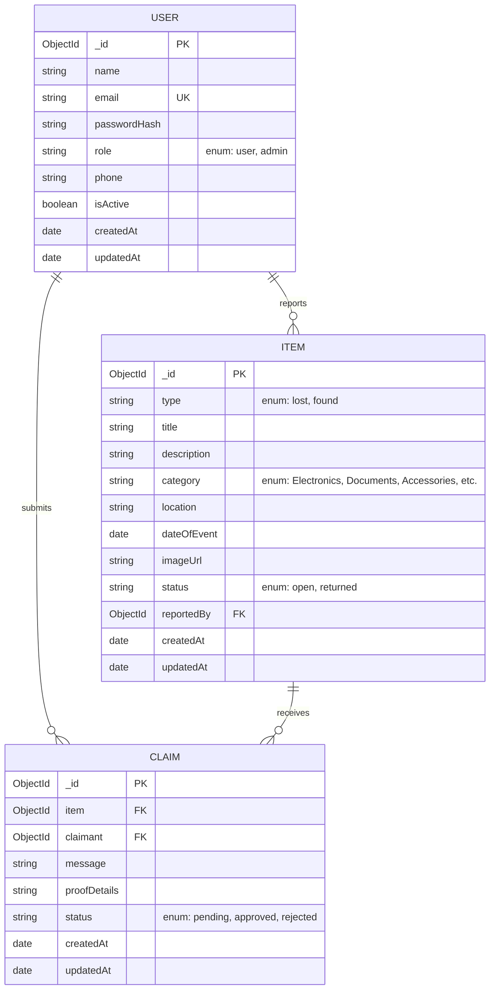

# Backend Schema & Data Architecture

**Project Name**: Campus Lost and Found Portal  
**Document Version**: 1.0.0  
**Phase**: Phase 1 — Planning Documents (Task 4)  
**Status**: Ready for Review  

---

## 1. Entity Relationship (ER) Diagram



---

## 2. Comprehensive Data Dictionary

### 2.1 `User` Collection (`users`)

Represents registered campus students, faculty, staff, and administrative moderators.

| Field Name | BSON Type | Required | Default | Validation / Constraints | Description |
| :--- | :--- | :---: | :---: | :--- | :--- |
| `_id` | `ObjectId` | Yes | Auto | Unique 24-character hexadecimal identifier. | Primary key. |
| `name` | `String` | Yes | - | `trim: true`, max 100 characters. | Full name of the user. |
| `email` | `String` | Yes | - | `unique: true`, `lowercase: true`, `trim: true`, valid email format. | Campus email address used as login identity. |
| `passwordHash` | `String` | Yes | - | Bcrypt hash string (salt cost 10). | Securely hashed password. Never returned in API queries. |
| `role` | `String` | Yes | `"user"` | `enum: ["user", "admin"]`. | User authorization level. |
| `phone` | `String` | No | `""` | `trim: true`, max 20 characters. | Optional contact number. Masked until claim approval. |
| `isActive` | `Boolean` | Yes | `true` | Boolean flag. | Account activation status. Deactivated accounts cannot log in. |
| `createdAt` | `Date` | Yes | Auto | Mongoose timestamp. | Account creation date. |
| `updatedAt` | `Date` | Yes | Auto | Mongoose timestamp. | Last profile modification date. |

### 2.2 `Item` Collection (`items`)

Represents lost or found item reports published across campus.

| Field Name | BSON Type | Required | Default | Validation / Constraints | Description |
| :--- | :--- | :---: | :---: | :--- | :--- |
| `_id` | `ObjectId` | Yes | Auto | Unique 24-character hexadecimal identifier. | Primary key. |
| `type` | `String` | Yes | - | `enum: ["lost", "found"]`. | Type of report: item lost or item found. |
| `title` | `String` | Yes | - | `trim: true`, max 100 characters. | Short recognizable title. |
| `description` | `String` | Yes | - | `trim: true`, max 1000 characters. | Detailed physical description and identifying context. |
| `category` | `String` | Yes | - | `enum: ["Electronics", "Documents", "Accessories", "Books", "Bags", "Keys", "Clothing", "Other"]`. | Item taxonomy classification. |
| `location` | `String` | Yes | - | `trim: true`, max 150 characters. | Specific campus venue where item was lost or found. |
| `dateOfEvent` | `Date` | Yes | - | Valid Date object. | Calendar date when the item was lost or discovered. |
| `imageUrl` | `String` | No | `""` | Valid URL (Cloudinary `https://...`) or local disk route (`/uploads/...`). | Attached photograph of the item. |
| `status` | `String` | Yes | `"open"` | `enum: ["open", "returned"]`. | Status of the listing. Set to `"returned"` upon approved claim. |
| `reportedBy` | `ObjectId` | Yes | - | `ref: "User"`. | Foreign key linking to the reporting user document. |
| `createdAt` | `Date` | Yes | Auto | Mongoose timestamp. | Timestamp when report was submitted. |
| `updatedAt` | `Date` | Yes | Auto | Mongoose timestamp. | Timestamp of last report edit. |

### 2.3 `Claim` Collection (`claims`)

Represents ownership claims submitted on an open item.

| Field Name | BSON Type | Required | Default | Validation / Constraints | Description |
| :--- | :--- | :---: | :---: | :--- | :--- |
| `_id` | `ObjectId` | Yes | Auto | Unique 24-character hexadecimal identifier. | Primary key. |
| `item` | `ObjectId` | Yes | - | `ref: "Item"`. | Foreign key pointing to the target item. |
| `claimant` | `ObjectId` | Yes | - | `ref: "User"`. | Foreign key pointing to the user submitting the claim. |
| `message` | `String` | Yes | - | `trim: true`, max 500 characters. | Claimant's explanatory message to the reporter. |
| `proofDetails` | `String` | Yes | - | `trim: true`, max 1000 characters. | Specific private identifying proof (serial number, lockscreen, etc.). |
| `status` | `String` | Yes | `"pending"` | `enum: ["pending", "approved", "rejected"]`. | Moderation status of the claim. |
| `createdAt` | `Date` | Yes | Auto | Mongoose timestamp. | Timestamp when claim was submitted. |
| `updatedAt` | `Date` | Yes | Auto | Mongoose timestamp. | Timestamp when decision was made. |

---

## 3. Database Indexing Strategy

To guarantee query performance under search volume, the following indexes are specified:

```javascript
// User Collection Indexes
userSchema.index({ email: 1 }, { unique: true });

// Item Collection Indexes
itemSchema.index({ title: "text", description: "text", location: "text" }); // Full-text search
itemSchema.index({ status: 1, type: 1, category: 1, createdAt: -1 });      // Faceted catalog filtering
itemSchema.index({ reportedBy: 1, createdAt: -1 });                        // User dashboard query

// Claim Collection Indexes
claimSchema.index({ item: 1, claimant: 1, status: 1 });                    // Duplicate claim prevention
claimSchema.index({ claimant: 1, createdAt: -1 });                         // User "Claims I Made" query
claimSchema.index({ item: 1, status: 1 });                                 // Reporter "Claims Received" query
```

---

## 4. Business Rules & Cascade Logic

1. **Self-Claim Invalidation**:
   - `Claim.create` must verify that `item.reportedBy.toString() !== req.user.id`. Self-claims are rejected with HTTP 400.
2. **Duplicate Pending Claim Prevention**:
   - A user cannot submit more than one active `pending` claim on the same item. Re-submissions return HTTP 409 Conflict.
3. **Approval Cascading**:
   - When a reporter approves a claim (`status: "approved"`):
     1. Target `Item` status transitions from `"open"` to `"returned"`.
     2. All competing claims on that item with `status: "pending"` are bulk-updated to `status: "rejected"`.
4. **Data Privacy Masking**:
   - Queries to `/api/claims/mine` populate claimant information (`name`, `email`, `phone`).
   - If `claim.status !== "approved"`, `claimant.email` and `claimant.phone` are strictly deleted from the returned payload.

---

## 5. Offline File-Based Storage Compatibility

When MongoDB is offline (`MONGODB_URI=local`), data is persisted to `server/data/*.json` via `LocalCollection`:
- `server/data/users.json`
- `server/data/items.json`
- `server/data/claims.json`

The `wrapDocument` and `sanitizeDocForSave` helpers in `server/config/localDb.js` ensure that document IDs, relationship populations (`ref`), and schema defaults (`status: "open"`, `role: "user"`) operate identically whether backed by MongoDB Atlas or local JSON files.

