# Implementation & Execution Roadmap

**Project Name**: Campus Lost and Found Portal  
**Document Version**: 1.0.0  
**Phase**: Phase 1 — Planning Documents (Task 5)  
**Status**: Ready for Review  

---

## 1. Project Phase Roadmap Overview

This implementation roadmap outlines the concrete execution sequence from Phase 2 through Phase 10. In accordance with the project's Working Rules, **every task is executed individually, verified with tangible evidence, and approved prior to advancing.**

```mermaid
flowchart LR
    P1["Phase 1: Planning Documents"] --> P2["Phase 2: Architecture Refactoring"]
    P2 --> P3["Phase 3: Design System & Brand"]
    P3 --> P4["Phase 4: UX, SEO & Features"]
    P4 --> P5["Phase 5: Performance Optimization"]
    P5 --> P6["Phase 6: Security Audit & Hardening"]
    P6 --> P7["Phase 7: Legal, Privacy & Compliance"]
    P7 --> P8["Phase 8: Stress Testing & QA"]
    P8 --> P9["Phase 9: Pre-Launch Checklist"]
    P9 --> P10["Phase 10: Post-Launch Plan"]
```

---

## 2. Granular Task Breakdown by Phase

### Phase 2: Architecture Refactoring
- **Task 2.1**: Establish Git version control branching strategy (`main`, `staging`, `feature/*`).
- **Task 2.2**: Configure staging environment deployment pipeline on Render.
- **Task 2.3**: Propose layered and modular folder structure for client and server (await approval).
- **Task 2.4**: Decouple business logic and data fetching hooks from React presentation components.
- **Task 2.5**: Audit for duplicate and dead code; compile list for user review and approval prior to removal.
- **Task 2.6**: Standardize centralized error handling and API response normalization across controllers.
- **Task 2.7**: Modularize reusable form, layout, and data-display components.
- **Task 2.8**: Document architecture and update Decision Log (`DECISIONS.md`).

### Phase 3: Design System & Brand Rules
- **Task 3.1**: Eliminate prohibited design patterns (remove purple gradients, pill buttons, custom cursors, scroll gimmicks).
- **Task 3.2**: Replace all emoji icons across navigation, cards, and buttons with accessible, lightweight SVG vector icons.
- **Task 3.3**: Remove informal or AI-sounding marketing copy, em dashes, and exaggerated metrics.
- **Task 3.4**: Implement collegiate design token stylesheet (Deep Navy Slate, Collegiate Blue, Crimson Red, Forest Emerald).
- **Task 3.5**: Add professional custom SVG/PNG favicon and remove any third-party AI attribution badges.

### Phase 4: Site Structure, UX, SEO & Interactive Features
- **Task 4.1**: Fix mobile responsiveness and eliminate horizontal overflow down to 375px (iPhone SE standard).
- **Task 4.2**: Refactor responsive mobile hamburger drawer with keyboard trap and ARIA labels.
- **Task 4.3**: Add custom branded 404 Not Found page.
- **Task 4.4**: Convert all phone numbers and email addresses into clickable `tel:` and `mailto:` action links.
- **Task 4.5**: Add SEO fundamentals: `sitemap.xml`, `robots.txt`, canonical tags, Open Graph meta tags, and schema.org JSON-LD markup.
- **Task 4.6**: Implement requested interactive features:
  - Accessible Dark Mode toggle with `localStorage` persistence.
  - Sticky navigation header with scroll shadow.
  - "Skip to Content" accessibility link and "Back to Top" button.
  - In-line password visibility toggle.
  - Skeleton loading placeholders for item cards and detail views.
  - Expandable FAQ accordion component.
  - Accessible cookie notice banner.

### Phase 5: Performance Optimization (Target: Lighthouse >= 90)
- **Task 5.1**: Audit and optimize client bundle with Rollup visualizer; split chunks and lazy-load route pages via `React.lazy`.
- **Task 5.2**: Implement image compression pipeline; convert uploads to WebP/AVIF format with lazy-loading attributes (`loading="lazy"`).
- **Task 5.3**: Audit dependencies in `package.json` across root, client, and server; compile unused packages for removal approval.
- **Task 5.4**: Register compound database indexes in Mongoose models to optimize search and faceted filtering.
- **Task 5.5**: Add Gzip/Brotli compression middleware (`compression`) to Express API responses.
- **Task 5.6**: Execute Lighthouse performance audit and document Core Web Vitals (LCP < 2.5s, CLS < 0.1, INP < 200ms).

### Phase 6: Security Audit & Hardening
- **Task 6.1**: Run secret scan across repository history and `.env` files.
- **Task 6.2**: Audit authentication and role-based access control (protecting admin routes and item ownership).
- **Task 6.3**: Harden API endpoints against XSS, CSRF, and NoSQL injection using sanitized inputs.
- **Task 6.4**: Configure robust Content Security Policy (CSP) and HSTS security headers in Helmet.
- **Task 6.5**: Add invisible honeypot anti-spam fields to registration, report, and claim forms.
- **Task 6.6**: Run dependency vulnerability audit (`npm audit`) and compile categorized security audit report (Critical, High, Medium, Low).

### Phase 7: Legal, Privacy & Compliance (DPDP Act & WCAG 2.1 AA)
- **Task 7.1**: Draft and publish required legal policies: Privacy Policy, Terms of Service, Cookie Policy, Non-Commercial Disclaimer.
- **Task 7.2**: Implement DPDP Act (India) compliance items: data minimization disclosure, user data deletion request workflow.
- **Task 7.3**: Add campus grievance officer contact details.
- **Task 7.4**: Execute automated accessibility audit (axe-core / Lighthouse Accessibility) verifying contrast ratios and keyboard navigation.

### Phase 8: Production Stress Testing
- **Task 8.1**: Implement double-click prevention on all form submission and claim approval buttons.
- **Task 8.2**: Test concurrent operations: simulate simultaneous claim approval and rejection race conditions.
- **Task 8.3**: Author automated integration test suite for core user journeys (Auth, Report, Claim, Approve, Admin).
- **Task 8.4**: Audit 5 threat vectors: credential stuffing, software vulnerabilities, misconfiguration, phishing risks, dependency integrity.

### Phase 9: Pre-Launch Checklist
- **Task 9.1**: Conduct cross-browser testing across Chrome, Safari, Edge, and mobile viewports.
- **Task 9.2**: Verify SSL/TLS padlock and HTTPS redirection.
- **Task 9.3**: Test health check endpoint (`/api/health`) and set up external uptime monitor ping (e.g. UptimeRobot / BetterStack).
- **Task 9.4**: Document automated rollback and database backup restoration procedure.
- **Task 9.5**: Compile final Decision Log, Assumptions List, and Pre-Launch Go/No-Go report.

### Phase 10: Post-Launch Plan
- **Task 10.1**: Formulate 48-hour launch observation protocol.
- **Task 10.2**: Provide recurring monthly maintenance schedule (dependency audits, security patches, backup drills).
- **Task 10.3**: Provide annual compliance and policy review guidelines.

---

## 3. Testing & Verification Gate Criteria

Prior to marking any individual task complete, the following four verification gates must be satisfied:
1. **Codebase Inspection**: Related files read and preserved per Engineering Rules E1–E4.
2. **Execution Proof**: Active terminal execution command, test suite result, or file diff provided.
3. **Build & Lint Cleanliness**: `npm run build` compiles with 0 errors.
4. **No Unapproved Removals**: Zero files, routes, or dependencies removed without explicit approval (E12).

